# JustDrinks LTD Analysis

**Where does the money come from, and where does it slip away?**

A Power BI report on a year of sales, purchasing and inventory for JustDrinks Ltd., a retailer of wine and spirits with 80 stores in 68 cities. It answers the six sections of the JustDrinks data-visualisation case study in 13 pages, with a star-schema model and DAX measures. A separate web version, built in HTML, CSS and JavaScript, lets you click through the same numbers and test what-if scenarios.


## Quick links

- 🌐 [Web dashboard](https://bihbrandysango-cloud.github.io/justdrinks-ltd-analysis/JustDrinks_Dashboard.html), the HTML version, with click-to-filter months, a what-if simulator and dark mode
- 🎬 [Walkthrough video (55 seconds)](docs/JustDrinks-walkthrough.mp4), a screen recording of the web dashboard
- 📊 [Power BI project](powerbi/JustDrinks%20LTD.pbip) (open in Power BI Desktop)
- 📄 [Strategic brief (PDF)](docs/JustDrinks-Strategic-Brief.pdf), which renders inline on GitHub
- 🎞️ [Presentation (PowerPoint)](docs/JustDrinks-Presentation.pptx) with the speech in the slide notes
- 🎤 [Speech and likely questions](docs/Speech.md)

---

> **A note on GitHub previews.** GitHub renders Markdown, PDFs and images inline. It does not preview PowerPoint files or Power BI projects in the browser. For those, GitHub shows a file page with a **Download** button on the top right. This is normal.

---

## Table of Contents

- [About the project](#about-the-project)
- [Headline findings](#headline-findings)
- [Report pages](#report-pages)
- [Repository structure](#repository-structure)
- [Data model](#data-model)
- [Run it locally](#run-it-locally)
- [Key insights](#key-insights)
- [Recommendations](#recommendations)
- [What changed in this version](#what-changed-in-this-version)
- [Tech stack](#tech-stack)
- [Limitations](#limitations)
- [License](#license)

---

## About the project

The leadership team asked for due diligence on sales, purchases and inventory for the year. The report follows the case-study sections in order: sales and the wine and spirits split, vendor activity, inventory and shelf time, store performance, strategic insights, and future data needs.

The work covers the full BI cycle:

1. **Modelling** six source files into a star schema with a date table, a store dimension and five fact tables
2. **Measuring** sales, purchases, inventory, margin and vendor ranking in 70 DAX measures
3. **Visualising** the results in a 13-page report with a navigation rail, plus a separate web dashboard
4. **Presenting** the findings in an 11-slide deck, a strategic brief and a speech

---

## Headline findings

| Metric | Value | Note |
|---|---|---|
| Sales | **$452.1M** | 80 stores in 68 cities |
| Spirits and wine | **64.19% and 35.81%** | Spirits $290.2M, wine $161.9M |
| Gross profit | **$130.2M** | A margin of 28.8%, with sales minus purchases of $321.9M |
| Sales from two sizes | **85%** | 750mL ($254.0M) and 1750mL ($132.1M) |
| Largest vendor | **15.8% of purchases** | Diageo, $51.0M. The top five vendors are 45% |
| December sales vs purchases | **$52.3M vs $26.3M ordered, $32.5M received** | Stock falls by about 973,000 units by order date and 375,000 by receipt date |

---

## Report pages

Click any image to view full size.

### 1. Home

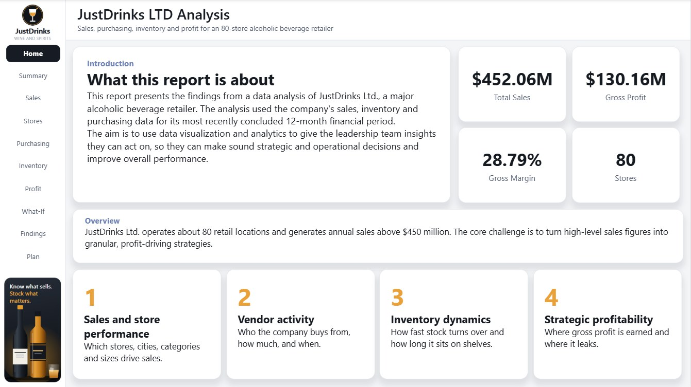

### 2. Executive summary

*Sales and purchases by month, four KPIs, category and size splits, and the vendor ranking.*

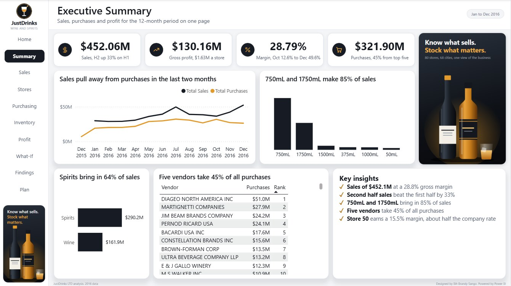

### 3. Sales

*Total sales, the wine and spirits split, and the most popular sizes in each.*

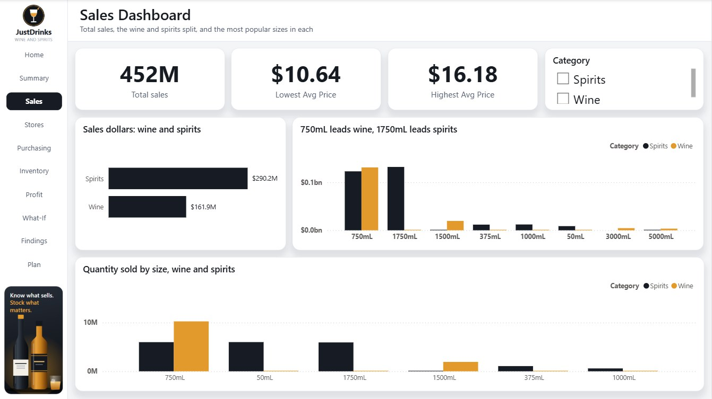

### 4. Stores and cities

*Average selling price by store and category, with the highest and lowest priced stores, and sales by city and store.*

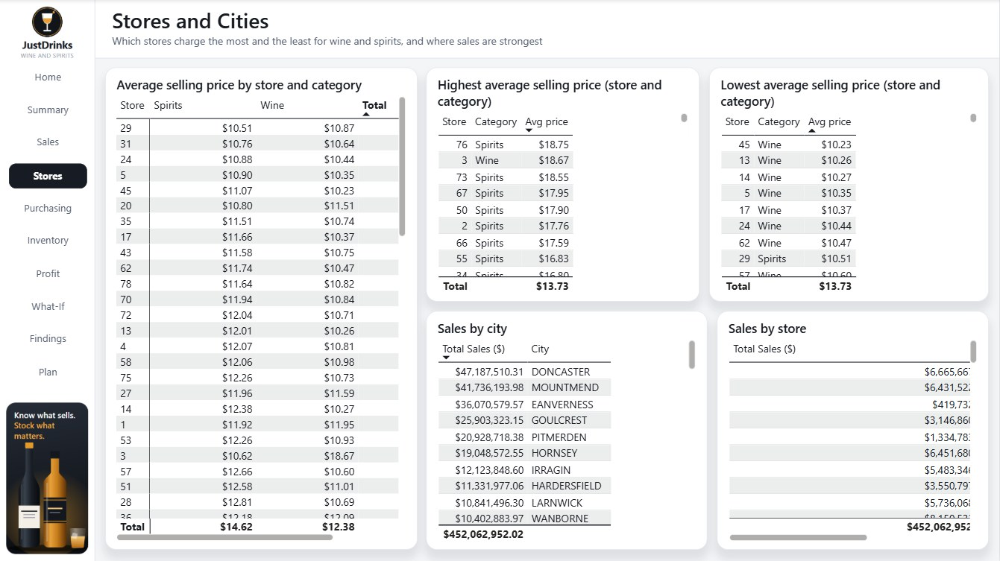

### 5. Purchasing

*Vendors by value and quantity, the critical suppliers, and purchases by month.*

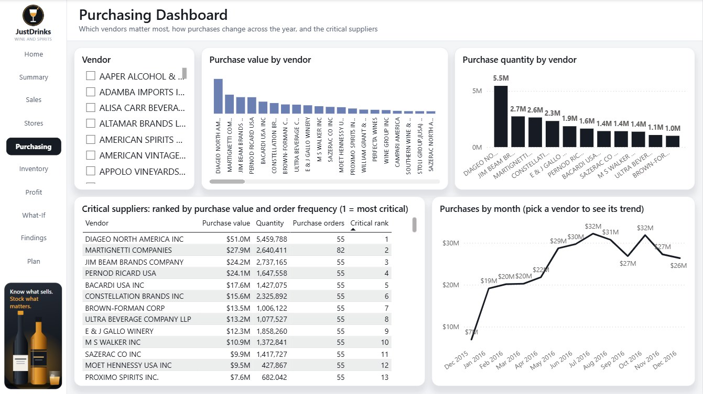

### 6. Inventory

*Units sold against units purchased, net stock change by month, and shelf time by brand and category.*

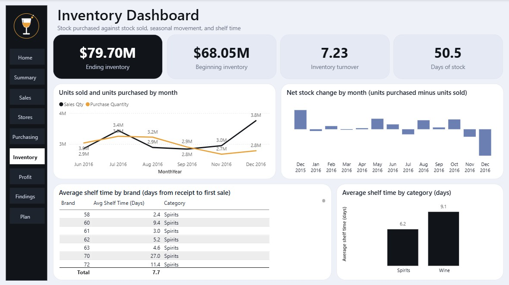

### 7. Profitability

*Sales and margin by month, gross profit by city and vendor, and brand profitability.*

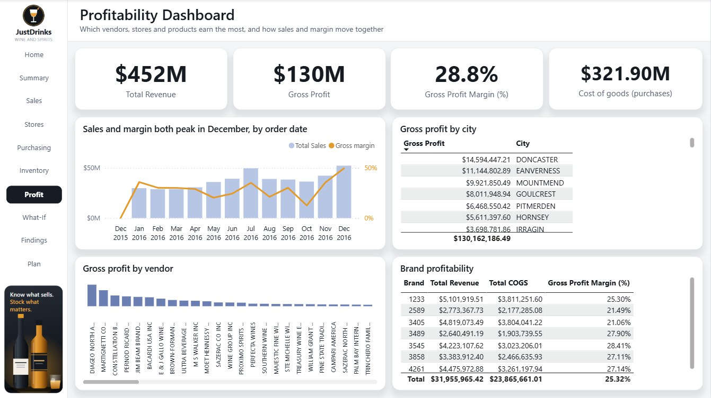

### 8. What-if scenarios

*What better vendor terms and stronger weak stores could add, in three scenarios. The live sliders are in the web dashboard.*

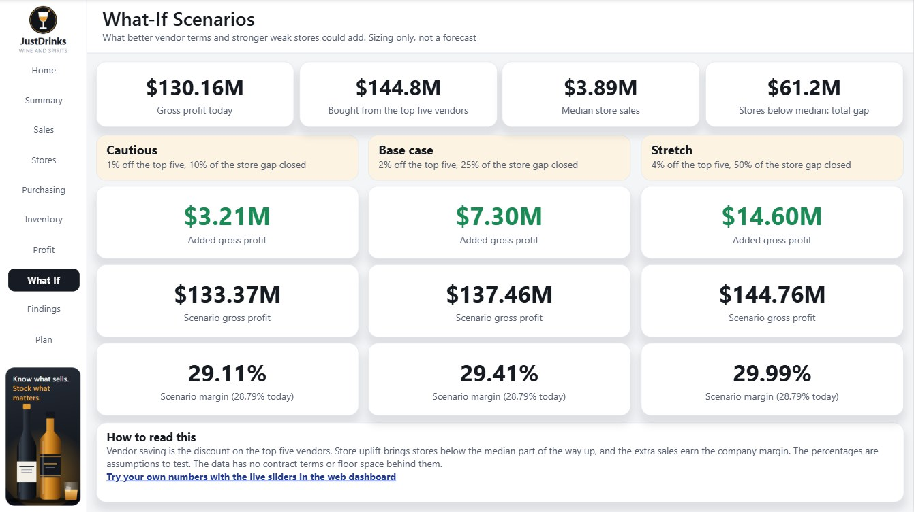

### 9. Key findings

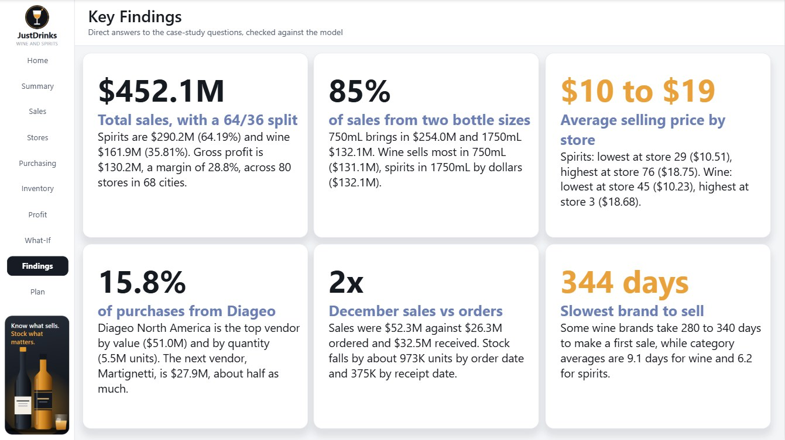

### 10. Insights

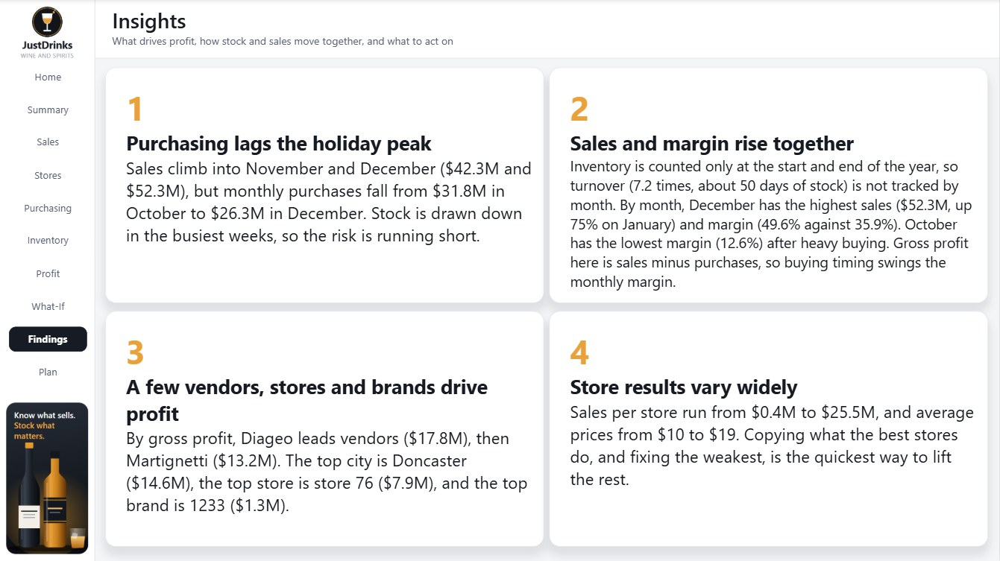

### 11. Recommendations

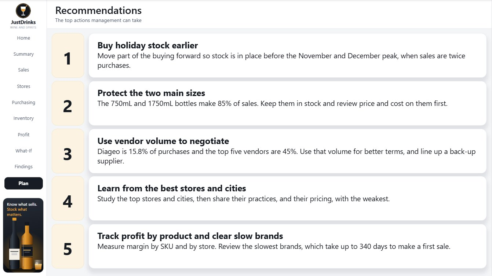

### 12. Future data needs

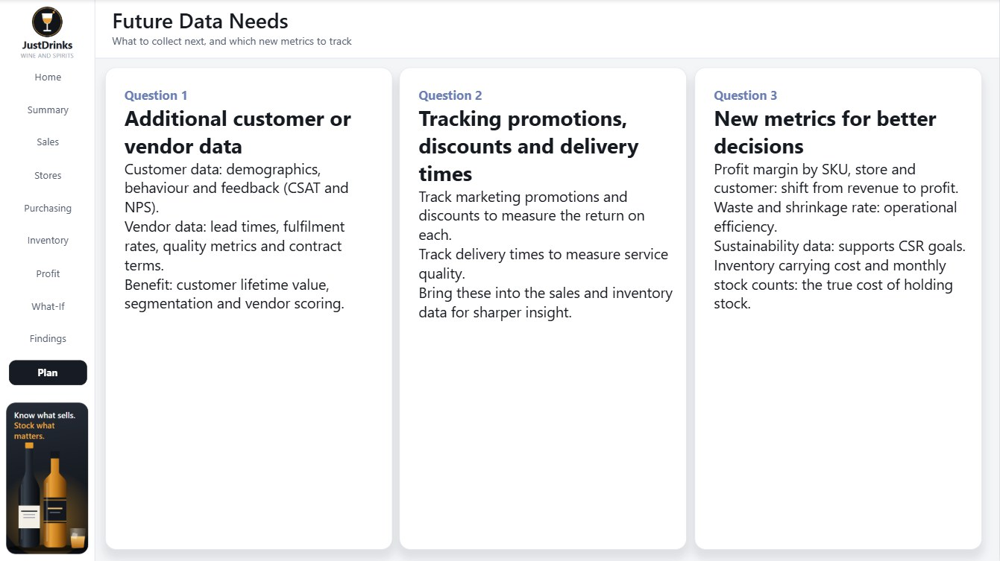

### 13. Summary

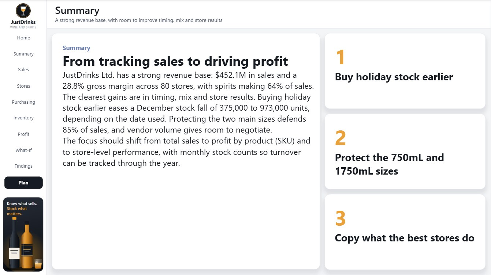

For the story behind each page, see [the strategic brief](docs/JustDrinks-Strategic-Brief.pdf).

---

## Repository structure

```
justdrinks-ltd-analysis/
│
├── README.md                                 This file
├── LICENSE                                   MIT
├── CONTRIBUTING.md                           Contribution guidelines
├── .gitignore
├── JustDrinks_Dashboard.html                 The interactive web dashboard
│
├── docs/
│   ├── JustDrinks-Strategic-Brief.pdf        Renders inline on GitHub
│   ├── JustDrinks-Presentation.pptx          11 slides, speech in the notes
│   ├── Speech.md                             The speech and likely questions
│   ├── logo.png
│   ├── screenshots/                          Report page JPGs and hero image
│   └── legacy/                               Earlier documents: data model notes,
│                                             build spec, outline, 13-slide deck, theme
│
└── powerbi/
    ├── JustDrinks LTD.pbip                   Open this in Power BI Desktop
    ├── JustDrinks LTD.Report/                13 pages and visuals as readable JSON
    └── JustDrinks LTD.SemanticModel/         Tables, relationships and 54 measures as TMDL
```

---

## Data model

The model is a star schema built from six source files for the 2016 year.

| Table | Type | Grain |
|---|---|---|
| `Date` | Dimension | One row per day, 2015 to 2017 |
| `DimStore` | Dimension | One row per store, with its city (80 stores, 68 cities) |
| `2017PurchasePricesDec` | Dimension and measure home | One row per brand, and the home of the DAX measures |
| `SalesFINAL12312016` | Fact | About 12.8M sales lines |
| `PurchasesFINAL12312016` | Fact | About 2.4M purchase lines |
| `InvoicePurchases12312016` | Fact | Purchase invoices with freight |
| `BegInvFINAL12312016` | Fact | Stock at the start of the year |
| `EndInvFINAL12312016` | Fact | Stock at the end of the year |

There are 20 relationships, all many-to-one and single-direction, and the 54 measures sit in display folders for sales, purchases, inventory, profitability, time intelligence and store analysis.

The case-study data is not included, because the sales file alone is 1.7 GB.

---

## Run it locally

1. Clone or download this repository.
2. Open `powerbi/JustDrinks LTD.pbip` in Power BI Desktop (free from Microsoft). To see data, point the model's CSV sources at your copy of the case-study files, using Transform data.
3. For the web dashboard, open [the live page](https://bihbrandysango-cloud.github.io/justdrinks-ltd-analysis/JustDrinks_Dashboard.html), or download `JustDrinks_Dashboard.html` and open it in a browser.

---

## Key insights

1. **Orders lag the holiday peak.** Sales climb into November and December ($42.3M and $52.3M), but monthly orders fall from $31.8M in October to $26.3M in December. Goods received rise to $32.5M in December, so stock falls by about 973,000 units by order date and 375,000 by receipt date.

2. **Sales and margin rise together.** December has the highest sales and margin (49.6% against 35.9% in January). October has the lowest margin (12.6%) after heavy buying. Stock is counted only at the start and end of the year, so turnover (7.2 times, about 50 days of stock) can't be tracked by month.

3. **A few vendors, stores and brands drive profit.** Diageo leads vendors on gross profit ($17.8M), then Martignetti ($13.2M). Doncaster is the top city ($14.6M) and store 76 the top store ($7.9M).

4. **Store results vary widely.** Sales per store run from $0.4M to $25.5M. Average prices run from about $10 to $19 in both wine and spirits.

5. **Two sizes carry the business.** The 750mL and 1750mL bottles make 85% of sales.

6. **Some brands sit a long time.** A few wine brands take 280 to 340 days to make a first sale, while category averages are 9.1 days for wine and 6.2 for spirits.

---

## Recommendations

| Priority | Action | Expected impact |
|---|---|---|
| High | Buy holiday stock earlier | Eases a December stock fall of 375,000 to 973,000 units, depending on the date used |
| High | Protect the 750mL and 1750mL sizes | They are 85% of sales |
| Medium | Use vendor volume to negotiate, and line up a back-up supplier | Diageo is 15.8% of purchases and the top five are 45% |
| Medium | Learn from the best stores and cities | Lifts the weakest stores |
| Medium | Track profit by product, and review the slowest brands | Moves decisions from sales to profit |

Full discussion in [the strategic brief](docs/JustDrinks-Strategic-Brief.pdf) and [the speech](docs/Speech.md).

---

## What changed in this version

While rebuilding the report I checked its text against the model and corrected these:

- **Wine and spirits codes.** The two were labelled the wrong way round. The group labelled wine held 50mL minis and 1750mL bottles, and the group labelled spirits held 5-litre boxes and 187mL four-packs. Spirits are now 64.19% of sales.
- **Inventory turnover.** About 7.2 (50 days of stock), not 2.0.
- **December purchasing.** There is no spike. Orders fall while sales peak.
- **Order date against receipt date.** December stock falls by about 973,000 units on order dates and about 375,000 on receipt dates. Receipts are closer to what reached the shelf, so the web dashboard shows both. Monthly margin moves the same way: 49.6% and 38% for December.
- **Store figures.** They are not identical across stores.
- **Critical Supplier Score.** It returned 1 for every vendor. It now ranks vendors by purchase value, with order count as the tie-breaker.

The earlier documents, including the first deck and the data model notes, are kept in `docs/legacy`. They describe the first version.

---

## Tech stack

| Layer | Tool |
|---|---|
| Data preparation | Power Query |
| Modelling and measures | Power BI, DAX |
| Visualisation | Power BI Desktop; HTML, CSS, JavaScript and SVG (web dashboard) |
| Documentation | PowerPoint, PDF |

---

## Limitations

- **The data is a case study.** JustDrinks is fictitious, so the findings show the analytical approach more than a real business.
- **Stock is counted only twice.** Turnover can't be tracked by month, and monthly figures are affected by the timing of buying.
- **Gross profit is sales minus purchases.** It is not sales minus the cost of the goods actually sold.
- **No reasons.** The data shows what happened, not why.

---

## License

Released under the MIT License. See [LICENSE](LICENSE).

---

**Built by Bih Brandy Sango** · Data Scientist and BI Analyst

- 🌐 [Web dashboard](https://bihbrandysango-cloud.github.io/justdrinks-ltd-analysis/JustDrinks_Dashboard.html)
- 📊 [Power BI project](powerbi/JustDrinks%20LTD.pbip)
- 📄 [Strategic brief](docs/JustDrinks-Strategic-Brief.pdf)
